<p align="center">
  
</p>

<p align="center">
  <a href="https://github.com/ishandutta2007/Awesome-Awesome-Awesome"></a>
  <a href="https://discord.gg/jc4xtF58Ve"></a>
  <a href="https://github.com/ishandutta2007/Awesome-Performance-Analytics/stargazers"></a>
  <a href="https://github.com/ishandutta2007/Awesome-Performance-Analytics/network/members"></a>
  <a href="https://github.com/ishandutta2007/Awesome-Performance-Analytics/blob/main/LICENSE"></a>
  <a href="https://github.com/ishandutta2007/Awesome-Performance-Analytics/pulls"></a>
  <a href="https://github.com/ishandutta2007"></a>
</p>

---

# 📊 Awesome Performance Analytics: Best KPI Tracking, Business Intelligence (BI) & Self-Service Dashboards

> ⚡ **A curated directory of top-tier enterprise SaaS platforms and leading open-source GitHub projects for Performance Analytics, KPI tracking, business intelligence, semantic layers, and operational data visualization.**

Welcome to the definitive ecosystem guide for **Performance Analytics**. Whether you are building an enterprise metrics governance layer, deploying self-service business intelligence (BI) for executive decision-making, or orchestrating code-first analytics-as-code dashboards, this resource indexes the most impactful tools in modern analytics.

Performance analytics enables organizations to define high-level key performance indicators (KPIs), detect statistical anomalies, evaluate operational efficiency, track historical trends across business workflows (ITSM, revenue operations, customer support, supply chain), and present live analytical insights without vendor lock-in.

---

## 📑 Table of Contents

- [🌐 Sector Overview & Market Dynamics](#-sector-overview--market-dynamics)
- [🏢 Enterprise SaaS & Hosted Platforms](#-enterprise-saas--hosted-platforms)
- [💻 Open-Source GitHub Projects](#-open-source-github-projects)
  - [Open-Source Summary & Star Rankings](#-open-source-summary--star-rankings)
  - [Detailed Open-Source Profiles](#-detailed-open-source-profiles)
- [🏗️ Recommended Architecture Archetypes](#️-recommended-architecture-archetypes)
- [🎯 Key Evaluation Criteria](#-key-evaluation-criteria)
- [📈 Star History](#-star-history)
- [🤝 How to Contribute](#-how-to-contribute)
- [💖 Support & Sponsorship](#-support--sponsorship)
- [📜 Disclaimer](#-disclaimer)

---

## 🌐 Sector Overview & Market Dynamics

The global **Business Intelligence (BI) and Performance Analytics** software market is valued at approximately **$33.6 billion in 2026** and is projected to expand to over **$54.2 billion by 2030**, reflecting a compound annual growth rate (CAGR) of ~10.4%. Growth is driven by automated insight discovery, embedded product analytics, generative AI copilot querying, and real-time operational metric collection.

The market exhibits **moderate fragmentation with concentrated cloud-hyperscaler dominance at the enterprise tier**:
- **Enterprise Concentration:** Tier-one cloud providers and enterprise giants (Microsoft Power BI, Salesforce/Tableau, Google Cloud/Looker, ServiceNow) command significant market share by embedding analytics directly into existing productivity suites, ERP workflows, and cloud storage agreements.
- **Dynamic Fragmentation & Challenger Niches:** Despite enterprise consolidation at the top, the category is **not a winner-take-all monopoly**. A vibrant ecosystem of specialized platforms thrives by addressing distinct pain points:
  - *Headless Semantic Layers* (Cube.js) that eliminate disparate metric definitions across warehouse consumers.
  - *Developer-First Analytics-as-Code* (Evidence.dev, Rill) for version-controlled Markdown/YAML reporting in Git.
  - *Self-Hosted Sovereign BI* (Apache Superset, Metabase, DataEase) for zero per-seat licensing fees and rigorous data privacy compliance.
  - *Conversational AI-Native BI* (ThoughtSpot, Wren AI) replacing static dashboards with ad-hoc natural language querying.

---

## 🏢 Enterprise SaaS & Hosted Platforms

The table below indexes category-leading SaaS performance analytics platforms, **sorted in descending order by company scale (revenue / market valuation)**.

| Platform & Provider | Company Scale (Valuation / Revenue) | Core Performance Analytics Focus | Starting Pricing (Specific Tier) | Free Tier & Free Trial Limits |
| :--- | :--- | :--- | :--- | :--- |
| **[Microsoft Power BI](https://powerbi.microsoft.com/)** | **~$3,100B Market Cap**<br>*(~$245B Annual Rev)* | Unified enterprise BI, Power Query data transformation, DAX formula modeling, and Copilot AI natural language generation natively linked into Microsoft 365. | **$10.00 / user / month**<br>*(Power BI Pro standalone; included in Microsoft 365 E5)* | **Free Forever Plan:** Power BI Desktop is 100% free forever for local data modeling, report design, and desktop dashboards.<br>**Free Trial:** 60-day free trial of Power BI Pro and Microsoft Fabric (64 CUs, 10 GB workspace storage). |
| **[Google Looker](https://looker.com/)** | **~$2,100B Market Cap**<br>*(~$350B Parent Rev; acquired for $2.6B)* | Governed metrics modeling using LookML, multi-cloud warehouse connectivity, BigQuery native push-down optimization, and governed semantic data models. | **$5,000.00 / month**<br>*(Looker Standard Platform Edition; bundles 10 standard users + 2 developers, billed annually)* | **Free Forever Plan:** Looker Studio is 100% free with unlimited reports, 800+ data connectors, and sharing.<br>**Free Trial:** 30-day free trial for Looker Studio Pro ($9/user/mo tier); enterprise Looker sandbox via Google Cloud sales POC. |
| **[Tableau](https://www.tableau.com/)** | **~$280B Market Cap**<br>*(~$35B Parent Rev; acquired for $15.7B)* | Deep visual analytics powered by VizQL, Tableau Catalog metric lineage, row-level security, and Tableau Pulse automated KPI digest delivery. | **$15.00 / user / month**<br>*(Viewer tier; requires at least 1 Creator seat at $75.00/user/month; $900/year minimum platform entry)* | **Free Forever Plan:** Tableau Public is 100% free forever with 10 GB cloud storage (all published sheets/dashboards are public).<br>**Free Trial:** 14-day fully-featured free trial of Tableau Desktop & Tableau Cloud (no credit card required). |
| **[ServiceNow Performance Analytics](https://www.servicenow.com/)** | **~$190B Market Cap**<br>*(~$10B Annual Rev)* | Native workflow performance analytics, process KPI indicators, historical scorecards, SLA trend forecasting, and service bottleneck diagnostics across the Now Platform. | **~$70.00 / fulfiller / month**<br>*(Bundled within ITSM Professional or available as a step-up add-on at ~$40–$70/fulfiller/mo)* | **Free Forever Plan:** Personal Developer Instance (PDI) through the ServiceNow Developer Program is free indefinitely with full Performance Analytics enabled (must log in once every 10 days to prevent reclamation). |
| **[MicroStrategy ONE](https://www.microstrategy.com/)** | **~$50B Market Cap**<br>*(~$500M Annual Rev)* | HyperIntelligence ambient zero-click analytics cards, enterprise semantic graph, governed Dossier reporting, and autonomous AI agents. | **$13.00 / user / month**<br>*(Standard Viewer/Reporting seat tier, billed annually)* | **Free Trial:** 30-day free trial of MicroStrategy Cloud on AWS or Azure (pre-configured instance, up to 10 users, preloaded enterprise sample datasets, and full AI/Dossier features). |
| **[Qlik Sense](https://www.qlik.com/)** | **~$10B Valuation**<br>*(~$1.2B Annual Rev; Thoma Bravo)* | Associative calculation engine indexing all relationship permutations without pre-aggregated cubes, augmented analytics, and AutoML pipeline integration. | **$300.00 / month**<br>*(Starter Tier: covers up to 10 users and 10 GB data capacity, billed annually at $3,600/year)* | **Free Trial:** 30-day full-featured free trial of Qlik Cloud Analytics (capped at 5 users and 5 GB data capacity; no credit card required). |
| **[ThoughtSpot](https://www.thoughtspot.com/)** | **~$4.2B Valuation**<br>*(~$150M ARR)* | Relational search-driven analytics, generative natural language querying (ThoughtSpot Sage), AI-powered automated anomaly detection (SpotIQ), and embedded analytics. | **$25.00 / user / month**<br>*(Essentials Plan: supports small teams 5–50 users up to 25 million data rows, billed annually)* | **Free Forever Plan:** ThoughtSpot Embedded Developer Edition is free for 1 year (up to 10 users, full SDK access).<br>**Free Trial:** 14-day free trial of ThoughtSpot Cloud (unlimited searches and SpotIQ insights, no credit card required). |
| **[Sisense](https://www.sisense.com/)** | **~$1.2B Valuation**<br>*(~$150M ARR)* | High-performance ElastiCube in-chip data engine, white-label embedded analytics SDKs (Compose SDK), and git-integrated developer analytics portals. | **$2,083.33 / month**<br>*(Self-Service / Essential platform tier billed annually starting at $25,000/year)* | **Free Trial:** 14-day interactive cloud test drive with pre-configured connectors, elastic caching models, and embedded widget builders. |
| **[Domo](https://www.domo.com/)** | **~$350M Market Cap**<br>*(~$320M Annual Rev)* | Cloud-native operational business management suite, 1,000+ pre-built ETL connectors, real-time KPI mobile cards, and low-code App Studio. | **$2,500.00 / month**<br>*(Standard consumption tier billed annually starting at $30,000/year; base credit rate ~$3.25/credit)* | **Free Trial:** 30-day free trial with unlimited users, 300 platform consumption credits, full access to connectors, and data flow pipelines (no credit card required). |
| **[GoodData](https://www.gooddata.com/)** | **~$300M Valuation**<br>*(~$40M ARR)* | Multi-tenant headless BI engine, analytics-as-code configuration, unified metrics layer, and white-labeled embedded web component dashboards. | **$1,500.00 / month**<br>*(Professional Platform Tier + $20.00 / workspace / month, billed annually)* | **Free Forever Plan:** Community / Developer Edition ($0 forever for up to 10 workspaces, unlimited users, and REST API embedding).<br>**Free Trial:** 30-day free trial of GoodData.AI Cloud. |

---

## 💻 Open-Source GitHub Projects

Open-source performance analytics tools grant engineering and business teams full infrastructure sovereignty, custom extensibility, and auditability without per-seat licensing penalties.

### 🌟 Open-Source Summary & Star Rankings

The table below lists top open-source projects, **sorted strictly in descending order by GitHub Stars_Count**. Each Stars_Badge links directly to that repository's stargazers community page.

| Project & Repo Link | GitHub_Stars_Badge | Primary Language / Stack | Primary Focus Area | License |
| :--- | :--- | :--- | :--- | :--- |
| **[Grafana](https://github.com/grafana/grafana)** | [](https://github.com/grafana/grafana/stargazers) | TypeScript, Go | Real-time time-series operational KPI dashboards & infrastructure monitoring | AGPLv3 |
| **[Apache Superset](https://github.com/apache/superset)** | [](https://github.com/apache/superset/stargazers) | Python, TypeScript | Enterprise warehouse BI, SQL Lab IDE, 40+ chart visualizations, granular RBAC | Apache 2.0 |
| **[Metabase](https://github.com/metabase/metabase)** | [](https://github.com/metabase/metabase/stargazers) | Clojure, TypeScript | User-friendly self-service queries, visual question builder, automated digests | AGPLv3 |
| **[Streamlit](https://github.com/streamlit/streamlit)** | [](https://github.com/streamlit/streamlit/stargazers) | Python | Fast Python-based interactive data apps, reactive KPI dashboards, and ML tools | Apache 2.0 |
| **[SigNoz](https://github.com/SigNoz/signoz)** | [](https://github.com/SigNoz/signoz/stargazers) | Go, TypeScript, ClickHouse | Application performance analytics, APM metrics, distributed tracing, and SLA alerting | Apache 2.0 |
| **[Redash](https://github.com/getredash/redash)** | [](https://github.com/getredash/redash/stargazers) | Python, JavaScript | Collaborative SQL querying, automated dashboard scheduling, and webhook alerts | BSD-2-Clause |
| **[DataEase](https://github.com/dataease/dataease)** | [](https://github.com/dataease/dataease/stargazers) | Java, Vue.js | Drag-and-drop open-source BI dashboard platform alternative to Tableau/Power BI | Apache 2.0 |
| **[Plotly Dash](https://github.com/plotly/dash)** | [](https://github.com/plotly/dash/stargazers) | Python, React | Production-grade low-latency analytical web applications with deep chart reactivity | MIT |
| **[Cube.js](https://github.com/cube-js/cube)** | [](https://github.com/cube-js/cube/stargazers) | Rust, TypeScript | Headless universal semantic layer, pre-aggregations, sub-second query caching | Apache 2.0 |
| **[Wren AI](https://github.com/Canner/WrenAI)** | [](https://github.com/Canner/WrenAI/stargazers) | TypeScript, Python | AI-native conversational BI engine translating natural language to governed SQL | Apache 2.0 |
| **[PyGWalker](https://github.com/Kanaries/pygwalker)** | [](https://github.com/Kanaries/pygwalker/stargazers) | Python, TypeScript | Lightweight interactive Tableau-like visual exploration UI inside Jupyter Notebooks | Apache 2.0 |
| **[Evidence.dev](https://github.com/evidence-dev/evidence)** | [](https://github.com/evidence-dev/evidence/stargazers) | Svelte, JavaScript | Analytics-as-code framework: Markdown + SQL compiled into fast static reports | MIT |
| **[Lightdash](https://github.com/lightdash/lightdash)** | [](https://github.com/lightdash/lightdash/stargazers) | TypeScript | Git-integrated BI platform turning dbt semantic models into self-serve metrics | MIT |
| **[Tremor](https://github.com/tremorlabs/tremor)** | [](https://github.com/tremorlabs/tremor/stargazers) | TypeScript, React | Modular, accessible React & Tailwind UI component library for building modern dashboards | Apache 2.0 |
| **[Rill Data](https://github.com/rilldata/rill)** | [](https://github.com/rilldata/rill/stargazers) | Go, Svelte, DuckDB | Code-native BI and fast operational dashboards backed by DuckDB and ClickHouse | Apache 2.0 |

---

### 🔍 Detailed Open-Source Profiles

#### 1. [Grafana](https://github.com/grafana/grafana) [](https://github.com/grafana/grafana/stargazers)
- **Primary Focus:** Operational KPI dashboards, time-series monitoring, and distributed system observability.
- **Why it matters:** The undisputed gold standard for time-series visualization. Connects natively to Prometheus, InfluxDB, Loki, and relational databases. Best suited for real-time systems, operational uptime scorecards, and IoT/hardware performance metrics.

#### 2. [Apache Superset](https://github.com/apache/superset) [](https://github.com/apache/superset/stargazers)
- **Primary Focus:** Full-scale enterprise business intelligence and interactive data exploration over modern data lakes and warehouses.
- **Why it matters:** Backed by the Apache Software Foundation and Preset, Superset offers 40+ visualization plugins, a comprehensive SQL Lab query IDE, dataset semantic caching, row-level security (RLS), and support for any SQL-speaking data warehouse via SQLAlchemy.

#### 3. [Metabase](https://github.com/metabase/metabase) [](https://github.com/metabase/metabase/stargazers)
- **Primary Focus:** Non-technical self-service analytics and rapid question/answer dashboard generation.
- **Why it matters:** Deploys in minutes via a single Docker container or JAR. Features an intuitive visual query builder that lets business stakeholders filter, summarize, and drill down into data without writing SQL. Includes automated Slack/email subscription pulses.

#### 4. [Streamlit](https://github.com/streamlit/streamlit) [](https://github.com/streamlit/streamlit/stargazers)
- **Primary Focus:** Pythonic data app creation for rapid analytics prototyping and model dashboards.
- **Why it matters:** Enables data scientists and analysts to convert Python data analysis scripts into full interactive performance dashboards in pure Python, complete with sliders, charts, file uploaders, and real-time state re-execution.

#### 5. [SigNoz](https://github.com/SigNoz/signoz) [](https://github.com/SigNoz/signoz/stargazers)
- **Primary Focus:** Full-stack APM performance analytics, latency percentile tracking, error rates, and OpenTelemetry telemetry.
- **Why it matters:** Built on top of ClickHouse columnar storage for lightning-fast aggregation, SigNoz provides a modern open-source alternative to Datadog for tracking service-level objectives (SLOs), p99 latency KPIs, and infrastructure health.

#### 6. [Redash](https://github.com/getredash/redash) [](https://github.com/getredash/redash/stargazers)
- **Primary Focus:** SQL-first dashboarding, query sharing, and parameter-driven report generation.
- **Why it matters:** Connects to dozens of SQL and NoSQL sources. While core development cadence has stabilized, Redash remains widely adopted for lightweight internal reporting and quick SQL query visualization.

#### 7. [DataEase](https://github.com/dataease/dataease) [](https://github.com/dataease/dataease/stargazers)
- **Primary Focus:** Visual drag-and-drop dashboard design engineered as an open-source alternative to Tableau and FineBI.
- **Why it matters:** Features an extensive library of interactive templates, zero-code layout builders, multi-tenant workspace isolation, and rich support for relational databases, Doris, and StarRocks.

#### 8. [Plotly Dash](https://github.com/plotly/dash) [](https://github.com/plotly/dash/stargazers)
- **Primary Focus:** Low-latency analytical web applications and custom data visualization pipelines.
- **Why it matters:** Couples Plotly.js chart rendering with Flask and React. Built for enterprise computational environments where complex calculation engines (Python/R) must execute in response to UI interactions.

#### 9. [Cube.js](https://github.com/cube-js/cube) [](https://github.com/cube-js/cube/stargazers)
- **Primary Focus:** Universal headless semantic layer, metrics consistency, and sub-second SQL API caching.
- **Why it matters:** Solves the "split metrics" crisis where different dashboard tools report different numbers for the same KPI. Sits between the database and visualization frontends, pre-aggregating data in Cube Store and enforcing centralized role-based security.

#### 10. [Wren AI](https://github.com/Canner/WrenAI) [](https://github.com/Canner/WrenAI/stargazers)
- **Primary Focus:** Conversational business intelligence and AI-driven SQL translation.
- **Why it matters:** Pairs large language models with a contextual semantic modeling engine. Users can ask questions in plain English ("What was our retention rate by channel last month?") and Wren AI derives accurate SQL without hallucinating schema attributes.

#### 11. [PyGWalker](https://github.com/Kanaries/pygwalker) [](https://github.com/Kanaries/pygwalker/stargazers)
- **Primary Focus:** Embedded Tableau-like visual exploration interface for Python dataframes.
- **Why it matters:** Turns any Pandas or Polars dataframe into an interactive drag-and-drop graphic interface directly inside Jupyter Notebook, Streamlit, or web applications with a single line of code (`pyg.walk(df)`).

#### 12. [Evidence.dev](https://github.com/evidence-dev/evidence) [](https://github.com/evidence-dev/evidence/stargazers)
- **Primary Focus:** Code-first analytics-as-code framework compiling Markdown and SQL into web-ready static reports.
- **Why it matters:** Built specifically for data teams that value Git version control, continuous integration, and pull request reviews. Reports are declared in pure Markdown with embedded SQL code blocks and rendered with instant client-side reactivity.

#### 13. [Lightdash](https://github.com/lightdash/lightdash) [](https://github.com/lightdash/lightdash/stargazers)
- **Primary Focus:** dbt-native self-service business intelligence platform.
- **Why it matters:** Eliminates redundant metric definitions by transforming the existing dbt semantic project (`schema.yml`) directly into the BI data model. Changes committed in dbt are instantly reflected across charts and user queries.

#### 14. [Tremor](https://github.com/tremorlabs/tremor) [](https://github.com/tremorlabs/tremor/stargazers)
- **Primary Focus:** Modular React component framework designed specifically for dashboards and KPI widgets.
- **Why it matters:** Provides ready-to-use metric cards, callout badges, bar lists, sparklines, and progress bars styled with Tailwind CSS, accelerating internal dashboard UI development for frontend engineers.

#### 15. [Rill Data](https://github.com/rilldata/rill) [](https://github.com/rilldata/rill/stargazers)
- **Primary Focus:** Operational BI combining fast in-memory analytics engines (DuckDB / ClickHouse) with code-driven dashboards.
- **Why it matters:** Delivers sub-second response times on massive datasets by leveraging embedded columnar execution. Models, dimensions, and KPI scorecards are configured as declarative YAML files in source control.

---

## 🏗️ Recommended Architecture Archetypes

Modern performance analytics stacks generally adopt one of three battle-tested architecture archetypes:

```
[ Warehouse / Lakehouse ] (Snowflake, BigQuery, Databricks, ClickHouse)
            │
            ▼
┌───────────────────────────────────────────┐
│     Centralized Semantic Layer            │  <-- Cube.js / dbt Semantic Layer
│  (Governed metrics, dimensions, RBAC)     │
└─────┬───────────────────────────────┬─────┘
      │                               │
      ▼                               ▼
┌─────────────────────────┐     ┌─────────────────────────┐
│ Enterprise Self-Serve   │     │ Developer-First BI      │
│ Apache Superset /       │     │ Evidence.dev /          │
│ Metabase / Power BI     │     │ Rill / Streamlit        │
└─────────────────────────┘     └─────────────────────────┘
```

1. **Enterprise Cloud-Governed Stack:**
   - *Storage:* Snowflake / BigQuery / Databricks
   - *Semantic Modeling:* Looker (LookML) or Microsoft Fabric Semantic Models
   - *Consumption:* Power BI / Tableau dashboards with row-level security
2. **Open-Source Sovereign Stack:**
   - *Storage:* PostgreSQL / ClickHouse / Trino
   - *Semantic & Caching Layer:* Cube.js
   - *Self-Service Dashboards:* Metabase (for business users) + Apache Superset (for advanced analysts)
3. **Analytics-as-Code Stack:**
   - *Storage:* DuckDB / MotherDuck / ClickHouse
   - *Modeling:* dbt Core
   - *Dashboard Framework:* Lightdash or Evidence.dev deployed via Git CI/CD

---

## 🎯 Key Evaluation Criteria

When selecting a performance analytics solution, evaluate platforms against these operational dimensions:

1. **Metric Governance:** Does the tool enforce a single source of truth for calculations (e.g. ARR, Churn, Uptime), or can individual users define duplicate, contradictory formulas?
2. **Latency & Query Performance:** Does the platform query the warehouse directly, employ materialized rollups, or leverage in-memory vector/columnar caches (like DuckDB or ClickHouse)?
3. **Licensing Predictability:** Avoid unpredictable cost spikes by weighing per-seat models against consumption/capacity-based or open-source self-hosted deployments.
4. **Access Control & Multi-Tenancy:** Verify support for Row-Level Security (RLS), Column-Level Security (CLS), and multi-tenant workspace isolation for external customer-facing dashboards.
5. **AI & Natural Language Querying:** Ensure AI integrations use governed semantic layers rather than raw schema guessing to prevent inaccurate data interpretations.

---

## 📈 Star History

[](https://star-history.dera.page/#ishandutta2007/Awesome-Performance-Analytics&type=date&legend=top-left)

---

## 🤝 How to Contribute

Contributions to expand and update this performance analytics directory are warmly welcomed!

1. **Fork** the repository on GitHub.
2. **Create a branch** for your update (`git checkout -b feature/add-new-analytics-tool`).
3. **Edit `README.md`** following the established format:
   - For SaaS tools: Include specific pricing tiers, verified free tier limits, and corporate scale.
   - For Open-Source tools: Include GitHub repository links, official license, and exact Stars_Badges.
4. **Submit a Pull Request** with a concise summary explaining why the tool belongs in this curated collection.

---

## 💖 Support & Sponsorship

Thank you so much for exploring and using **Awesome-Performance-Analytics**! 🌟

If you find this curated collection useful for your team, organization, or personal projects, please consider supporting the project:

- ⭐ **Star this repository** to help others discover it.
- 🍴 **Fork the repo** to contribute your own favorite tools, benchmarks, and guides.
- 📢 **Share it** with fellow data engineers, BI developers, analysts, and tech communities on X/Twitter, LinkedIn, and Discord.
- ☕ **Buy me a coffee / Sponsor**: If you'd like to support ongoing maintenance and new ecosystem insights, consider sponsoring via the [GitHub Sponsors Dashboard](https://github.com/sponsors/ishandutta2007). Your support is greatly appreciated!

---

## 📜 Disclaimer

- This is a community-curated directory intended for research, architectural evaluation, and educational purposes. Mention of specific vendors does not constitute an endorsement.
- All product names, logos, trademarks, and registered trademarks belong to their respective owners.
- Pricing tiers, free trial durations, and platform capabilities are subject to vendor updates. Always verify current commercial terms on official vendor websites before procurement.
